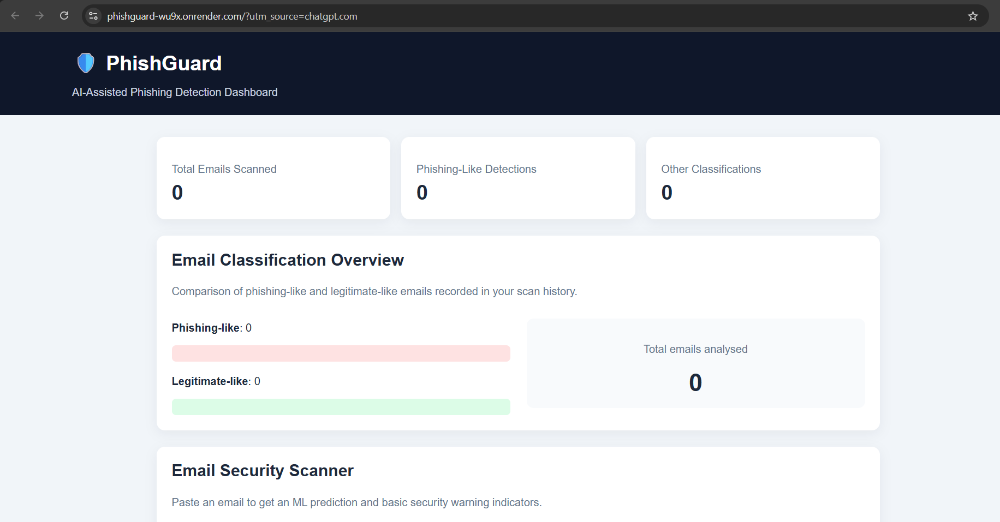
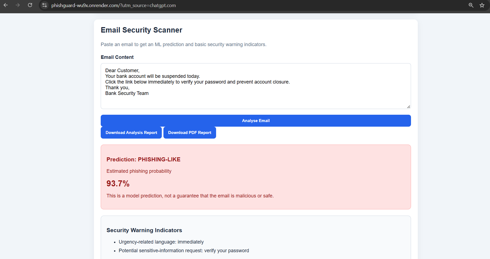
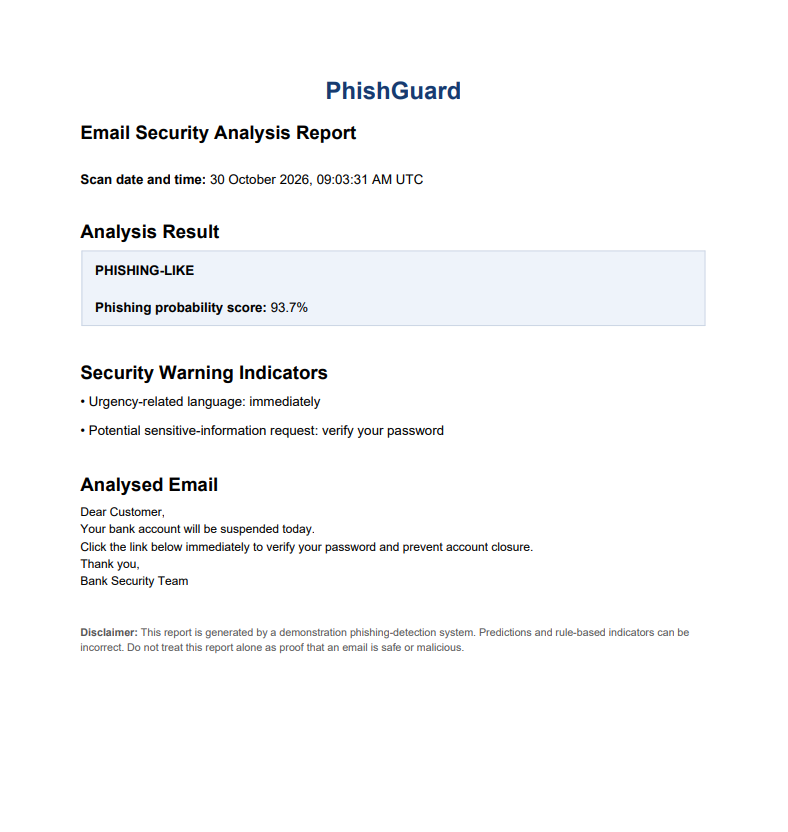

# 🛡️ PhishGuard – AI-Based Phishing Email Detection

PhishGuard is a machine-learning-based web application designed to identify potentially malicious phishing emails. It analyses email content, predicts whether an email is phishing-like or legitimate-like, and highlights suspicious indicators to help users understand potential email threats.

🌐 **Live Demo:** https://phishguard-wu9x.onrender.com

## 🚀 Features

- **Machine Learning Detection:** Analyses email text and predicts phishing-like or legitimate-like messages.
- **Phishing Probability Score:** Displays a prediction score to help users understand the model's assessment.
- **Security Warning Indicators:** Highlights suspicious URLs, urgency-related language, and sensitive-information requests.
- **Interactive Dashboard:** Displays scan statistics and a phishing-versus-legitimate classification chart.
- **HTML Analysis Reports:** Generates downloadable email analysis reports.
- **PDF Analysis Reports:** Generates downloadable PDF reports.
- **SQLite Database:** Stores scan statistics for the dashboard.
- **Input Validation:** Applies server-side email length validation and request-size restrictions.

## 🧰 Technologies Used

| Technology | Purpose |
|---|---|
| Python | Core programming language |
| Flask | Web application framework |
| Scikit-learn | Machine learning |
| Pandas | Dataset processing |
| Joblib | Model storage and loading |
| SQLite | Scan statistics storage |
| HTML & CSS | Frontend interface |
| ReportLab | PDF report generation |
| Render | Application deployment |
| Git & GitHub | Version control |

## ⚙️ How It Works

1. User enters email content into the PhishGuard scanner.
2. The application processes the submitted email text.
3. The trained machine learning model predicts the email category.
4. The application calculates a phishing probability score.
5. Security checks identify suspicious URLs, urgency-related terms, and sensitive-information requests.
6. The dashboard displays the analysis results.
7. Users can download the analysis as an HTML or PDF report.

## 📊 Model Performance

The model was evaluated using a held-out test dataset.

- **Dataset:** 17,522 cleaned and usable email records.
- **Training samples:** 14,017.
- **Testing samples:** 3,505.
- **Accuracy:** Approximately 98.15%.

*Note: These are results from the project's evaluation dataset. They do not guarantee the same accuracy on real-world emails.*

## 💻 Installation and Setup

### 1. Clone the repository

```bash
git clone https://github.com/Vaishnaviapshetty/PhishGuard.git
```

### 2. Navigate to the project folder

```bash
cd PhishGuard
```

### 3. Install dependencies

```bash
pip install -r requirements.txt
```

### 4. Run the application

```bash
python app.py
```

### 5. Open in your browser

```text
http://127.0.0.1:5000
```

## 🔐 Security and Limitations

- PhishGuard is an educational cybersecurity project and is not a replacement for enterprise email security systems.
- Model predictions and security indicators may produce false positives or false negatives.
- Avoid submitting confidential or personally identifiable email content to the public demonstration.
- Dashboard statistics are shared across the public demonstration.
- The application should receive further security testing before production use.

## 🔮 Future Enhancements

- Advanced URL reputation analysis.
- Domain and sender authentication checks.
- Improved phishing detection using additional datasets.
- More detailed threat analysis.
- Enhanced application security and access controls.

## 👩‍💻 Developer

**Vaishnavi Shetty**

Computer Science and Engineering – Cyber Security

GitHub: https://github.com/Vaishnaviapshetty

---

⭐ If you find this project interesting, consider starring the repository!

---

---

## 📸 Project Screenshots

### 1. PhishGuard Dashboard


### 2. Email Analysis Result


### 3. PDF Analysis Report

