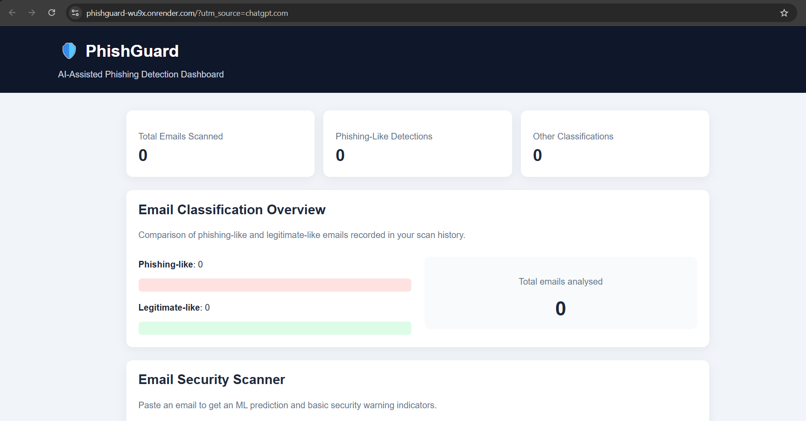
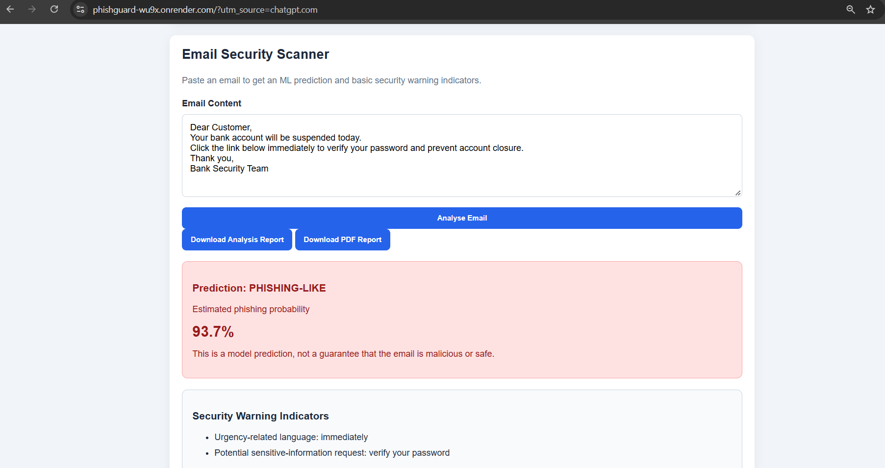
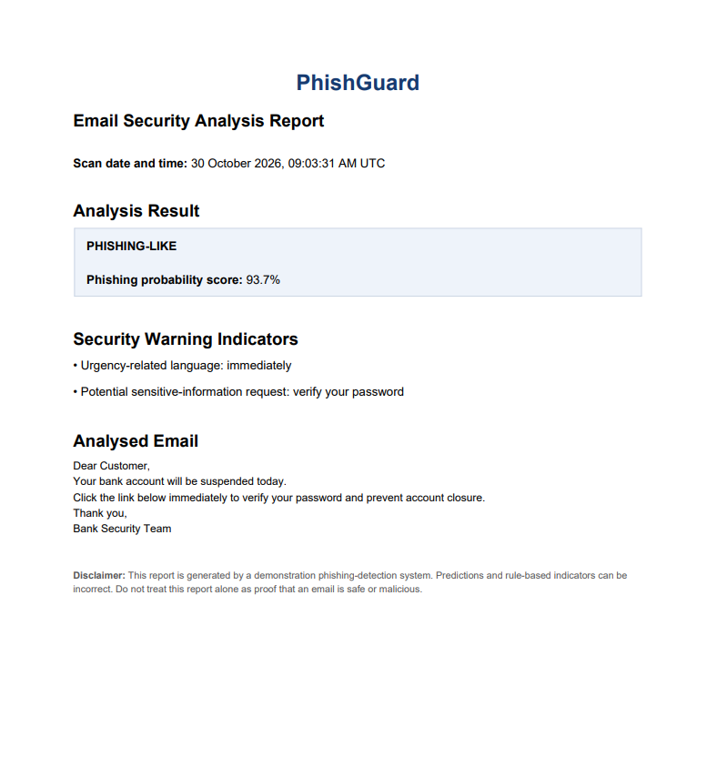

# 🛡️ PhishGuard – AI-Assisted Phishing Email Detection System

PhishGuard is a machine-learning-based web application designed to identify potentially malicious phishing emails. It analyses submitted email content, predicts whether an email is **PHISHING-LIKE** or **LEGITIMATE-LIKE**, and highlights suspicious indicators to help users understand potential email threats.

🌐 **Live Demo:** https://phishguard-wu9x.onrender.com

## 🚀 Features

- **Machine Learning Detection:** Classifies email content as phishing-like or legitimate-like using a trained machine learning model.
- **Phishing Probability Score:** Displays the model's estimated phishing probability.
- **Security Warning Indicators:** Identifies suspicious URLs, urgency-related language and sensitive-information requests.
- **URL Threat Analysis:** Checks URLs for suspicious characteristics, including HTTP usage, URL shorteners, IP addresses, unusual ports, suspicious keywords and lookalike domains.
- **Interactive Dashboard:** Displays scan statistics and a phishing-versus-legitimate classification chart.
- **HTML Analysis Reports:** Generates downloadable email analysis reports.
- **PDF Analysis Reports:** Generates downloadable PDF reports.
- **SQLite Database:** Stores scan history and dashboard statistics.
- **Input Validation:** Includes email length validation and request-size restrictions.

## 🧰 Technologies Used

| Technology | Purpose |
|---|---|
| Python | Core programming language |
| Flask | Web application framework |
| Scikit-learn | Machine learning |
| Pandas | Dataset processing |
| Joblib | Model storage and loading |
| SQLite | Scan history storage |
| HTML & CSS | Frontend interface |
| ReportLab | PDF report generation |
| Render | Application deployment |
| Git & GitHub | Version control |

## ⚙️ How It Works

1. The user enters email content into the PhishGuard scanner.
2. Flask processes the submitted email text.
3. The trained machine learning model predicts the email category.
4. The application displays the estimated phishing probability.
5. Security checks analyse the email for suspicious language and potential threats.
6. Extracted URLs are evaluated for suspicious characteristics.
7. The dashboard displays scan statistics and analysis results.
8. Users can download the analysis as an HTML or PDF report.

## 🔍 URL Threat Analysis

PhishGuard includes a rule-based URL analysis component that checks for potentially suspicious URL characteristics.

It checks for:

- HTTP connections.
- IP addresses used in URLs.
- URL shorteners.
- Lookalike domains, such as `paypa1.com`.
- Suspicious URL keywords such as `login`, `verify` and `secure`.
- Unusual or invalid port numbers.
- Other suspicious URL patterns.

The application assigns a risk score and categorises detected URL risks into four levels:

| Risk Level | Score |
|---|---:|
| LOW | Below 25 |
| MEDIUM | 25–49 |
| HIGH | 50–74 |
| CRITICAL | 75–100 |

These checks are intended to highlight suspicious characteristics, not to establish whether a URL is definitively malicious.

## 📊 Model Performance

The machine learning model was evaluated using a held-out test dataset.

| Evaluation Metric | Result |
|---|---:|
| Cleaned dataset | 17,522 emails |
| Training samples | 14,017 |
| Testing samples | 3,505 |
| Accuracy | 98.15% |

**Note:** These results are based on the project's evaluation dataset. They do not guarantee the same performance on real-world emails. Model predictions may produce false positives or false negatives.

## 💻 Installation and Setup

### 1. Clone the repository

```bash
git clone https://github.com/Vaishnaviapshetty/PhishGuard.git
```

### 2. Navigate to the project folder

```bash
cd PhishGuard
```

### 3. Install dependencies

```bash
pip install -r requirements.txt
```

### 4. Run the application

```bash
python app.py
```

### 5. Open the application

Visit the following address in your browser:

```text
http://127.0.0.1:5000
```

## 🔐 Security and Limitations

- PhishGuard is an educational cybersecurity project and is not a replacement for enterprise email security systems.
- Machine learning predictions and rule-based security checks may produce false positives or false negatives.
- Avoid submitting confidential or personally identifiable email content to the public demonstration.
- Dashboard statistics are shared across the public demonstration and may reset when the application restarts.
- The application requires further security testing before production use.

## 🔮 Future Enhancements

- Integration with external URL reputation services.
- Email sender and domain authentication checks.
- Improved phishing detection using additional datasets.
- More detailed threat analysis and reporting.
- Enhanced application security and access controls.

## 📸 Project Screenshots

### 1. PhishGuard Dashboard



### 2. Email Analysis Result



### 3. PDF Analysis Report



## 👩‍💻 Developer

**Vaishnavi Shetty**

Computer Science and Engineering – Cyber Security

GitHub: https://github.com/Vaishnaviapshetty

---

⭐ If you find this project interesting, consider starring the repository!
